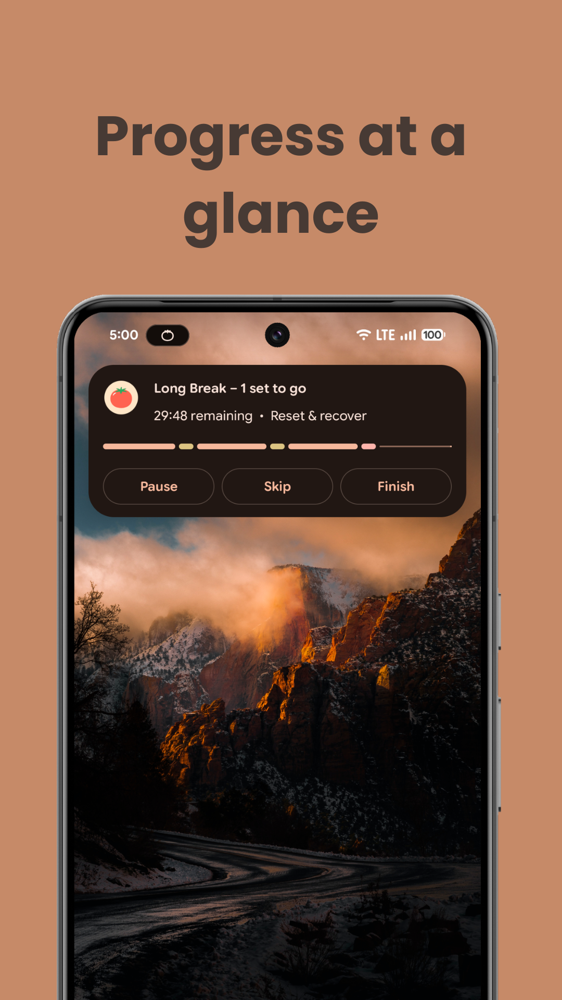

<div align="center">


<br/>

<table border="0" width="100%">
    <tr>
        <td width="30%" align="center" valign="middle">
            
        </td>
        <td width="70%" valign="middle">
            <h1>Sessions</h1>
            <h3>Your Personal Focus Companion</h3>
            <p><i>Precision-engineered productivity application designed to help you master your time and maintain flow state.</i></p>
        </td>
    </tr>
</table>

<p align="center">
  <a href="https://play.google.com/store/apps/details?id=com.yugentech.sessions"></a>
  <a href="https://github.com/MohammadAliUstad/Sessions/releases"></a>
</p>

<p align="center">
  <b>2,500+ Downloads</b> &nbsp;·&nbsp; <b>⭐ 4.9 Rating</b> &nbsp;·&nbsp; <b>60+ Reviews</b> on Google Play
</p>

<br/>

[Report Bug](https://github.com/MohammadAliUstad/Sessions/issues) · [Request Feature](https://github.com/MohammadAliUstad/Sessions/issues) · [Download Latest Release](https://github.com/MohammadAliUstad/Sessions/releases)

</div>

---

## Overview

Sessions transforms the concept of a simple timer into a comprehensive focus tool. Whether you're studying, coding, or writing, the application ensures your environment is optimized for concentration. It features a robust background service and intelligent reminder system that ensures your progress is tracked and your habits are maintained, even when life gets busy.

Sign in to keep your history backed up and synced across devices, or tap **Guest** to start focusing right away, with no account and everything kept on your phone.

---

## ✨ Key Features

### Intelligent Focus Engine
- **Focus Reminders:** Intelligent check-ins that trigger if you've been away too long, helping you stay on track.
- **Playful Nudges:** Smart, personalised reminders crafted around your actual task history and focus habits, distinct from focus reminders and designed to feel less like a notification and more like a friend checking in.
- **Customisable Cycles:** Define your exact Focus Duration, Short Break Duration, and Target Set count.
- **Flexible Long Breaks:** Opt into long breaks, set their duration, and choose the interval: every set, every 2 sets, every 3 sets, and so on up to your full target count. Long breaks can also be turned off entirely.

### Immersive Audio Environment
- **Curated Ambience:** Includes 6 high-quality background sounds: Rain, Brown Noise, Fireplace, Library, Riverside, and Forest.
- **Adaptive Audio Ducking:** Background volume intelligently lowers during breaks and rises during focus sessions.
- **Sensory Feedback:** Integrated haptic feedback and sound effects confirm interactions without needing to look at the screen.

### Reliability & System Integration
- **Live Activity Support:** Persistent notification on the lock screen and status bar allows you to track progress at a glance.
- **Quick Actions:** Skip focus or break periods directly from the notification tray for seamless session control.
- **Background Stability:** Engineered to resist aggressive battery optimization, ensuring your timer never stops unexpectedly.

### Accounts & Your Data
- **Sign In or Go Guest:** Sign in with email or Google to back up and sync your sessions, templates and profile, or continue as a guest without an account.
- **Private Guest Mode:** A guest's data never leaves the phone: no account is created and nothing is sent to the cloud. It works offline from the first launch.
- **Backup Files:** Guests can export their sessions, templates and profile to a single file and import it later. Signed in? Import a guest backup from Settings and it syncs to your account. Imports merge, so nothing is ever doubled up.

### Analytics & Personalization
- **Visual Insights:** Dedicated dashboard featuring heatmaps and metrics (Total Focus Time, Peak Productivity Hours).
- **Session Management:** Full control over your history: sort sessions by day, week, or month, and delete sessions individually, by period (daily, weekly, or monthly), or all at once.
- **Deep Theming:** 8 Color Themes (including Dynamic Material You), OLED Black Mode, and 6 Font options.
- **Home Layouts:** Choose how the timer screen looks: Classic, Refined or Studio.
- **Identity System:** Choose from a variety of animated avatars and set a custom display name.
- **10 Languages:** English, Spanish, Portuguese (Brazil), French, German, Hindi, Arabic, Japanese, Korean and Simplified Chinese, switchable in the app.

---

## 📱 Screenshots

<div align="center">

<table width="100%">
  <tr>
    <td align="center" width="25%">
      
      <br/><sub><b>Timer</b></sub>
    </td>
    <td align="center" width="25%">
      
      <br/><sub><b>Insights</b></sub>
    </td>
    <td align="center" width="25%">
      
      <br/><sub><b>Dashboard</b></sub>
    </td>
    <td align="center" width="25%">
       
      <br/><sub><b>Appearance</b></sub>
    </td>
  </tr>
  <tr>
    <td align="center" width="25%">
      
      <br/><sub><b>Settings</b></sub>
    </td>
    <td align="center" width="25%">
      
      <br/><sub><b>Notification</b></sub>
    </td>
    <td align="center" width="25%">
      
      <br/><sub><b>Edit Profile</b></sub>
    </td>
    <td align="center" width="25%">
      
      <br/><sub><b>About</b></sub>
    </td>
  </tr>
</table>

</div>

---

## Technical Architecture

Sessions is built using modern Android development standards, ensuring a codebase that is scalable, testable, and maintainable.

```text
Language:             Kotlin
UI Framework:         Jetpack Compose (Material 3)
Architecture:         MVVM + Clean Architecture
Dependency Injection: Koin
Local Database:       Room
Backend Services:     Firebase (Auth, Firestore, Analytics, Crashlytics)
Concurrency:          Kotlin Coroutines & Flow
Background Tasks:     WorkManager
Animations:           Lottie
```

### Tech Stack

* **Kotlin** - Modern, concise, and safe programming language.
* **Jetpack Compose** - Declarative UI toolkit for building native Android interfaces.
* **Material 3** - Latest Material Design system for beautiful, accessible UIs.
* **MVVM Architecture** - Separation of concerns for maintainable code.
* **Room Database** - Robust local data persistence.
* **WorkManager** - Reliable background task scheduling for smart reminders.
* **Firebase** - Authentication and cloud sync for signed-in users, plus usage analytics and crash reporting. Guest mode runs entirely on the device.
* **Coroutines & Flow** - Asynchronous programming made simple.
* **Lottie** - Animated icons throughout the app.

---

## Setup & Installation

### Prerequisites

* Android Studio (latest version recommended)
* JDK 11 or higher
* Android SDK API 26+

### Steps

1. **Clone the Repository**
```bash
git clone https://github.com/MohammadAliUstad/Sessions.git
cd Sessions
```

2. **Firebase Configuration**
* Create a project in the [Firebase Console](https://console.firebase.google.com/)
* Download the `google-services.json` file
* Place the file in the `app/` directory of the project
* In **Authentication**, enable the **Email/Password** and **Google** sign-in providers (guest mode needs no provider)
* Create a **Cloud Firestore** database. Each user's data is stored under `users/{uid}`, so set your security rules to allow access only when the signed-in user's ID matches `{uid}`

3. **Build & Run**
* Open the project in Android Studio
* Sync Gradle files
* Select your target device/emulator
* Click Run ▶️

---

## 🤝 Contributing

Contributions are what make the open source community such an amazing place to learn, inspire, and create. Any contributions you make are **greatly appreciated**.

1. Fork the Project
2. Create your Feature Branch (`git checkout -b feature/AmazingFeature`)
3. Commit your Changes (`git commit -m 'Add some AmazingFeature'`)
4. Push to the Branch (`git push origin feature/AmazingFeature`)
5. Open a Pull Request

---

## 📄 License

Sessions is free and open source software, licensed under the **GNU General Public License v3.0 or later** (`GPL-3.0-or-later`). See [`LICENSE`](LICENSE) for the full text and [`NOTICE.md`](NOTICE.md) for the copyright notice and additional terms.

In short, you may use, study, modify and share the code. If you distribute a modified version, you must release its full source code under the same license and keep the copyright notices.

- **Google libraries:** an additional permission allows the app to be built with Firebase, Google Play services and the Google Play Billing Library.
- **Earlier releases:** versions published before this change were released under the Apache License 2.0 and remain available under those terms.

### Name and branding

The license covers the code, not the brand. The **Sessions** name, the **Yugen Tech** name, the logo, the app icon and the artwork in `graphics/`, `badges/` and `screenshots/` are **not** licensed under the GPL and remain all rights reserved.

If you publish a fork, give it a different name, icon and application ID, and don't present it as an official Sessions release. You're welcome to describe it as "based on Sessions" and link back here. See [`NOTICE.md`](NOTICE.md) for details.

### Contributing and licensing

By submitting a pull request, you agree that your contribution is licensed under GPL-3.0-or-later.

---

## Contact & Support

If you encounter any issues or have suggestions for future updates, please open an issue on GitHub or contact the developer directly.

**Developer:** Mohammad Ali Ustad

**Email:** Mohammadaliustad@gmail.com

**Company:** Yugen Tech

<div align="center">

### Show Your Support

If you find this project helpful, please consider giving it a ⭐!

</div>

---

<div align="center">
<sub>Built with ❤️ by Yugen Tech</sub>
</div>
