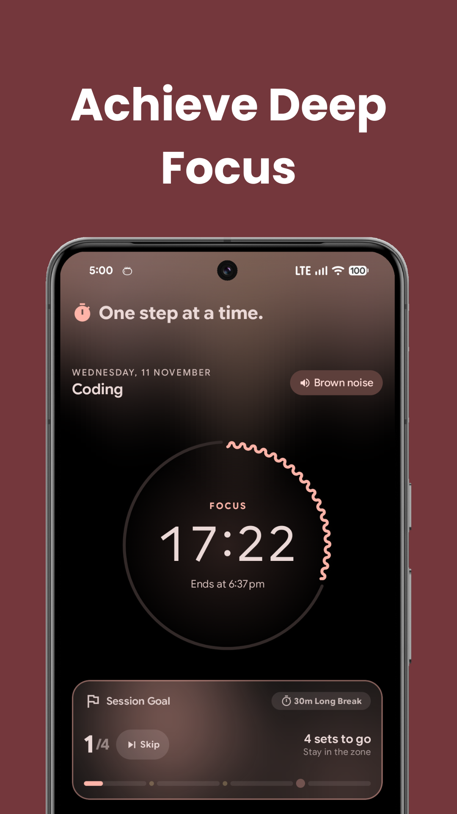
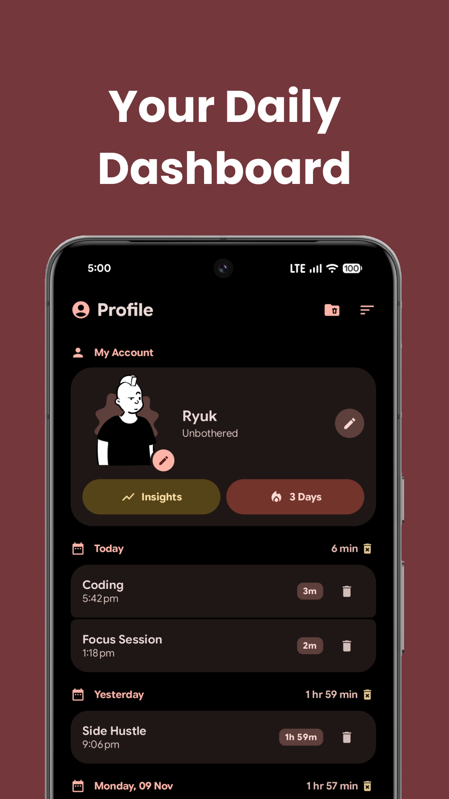
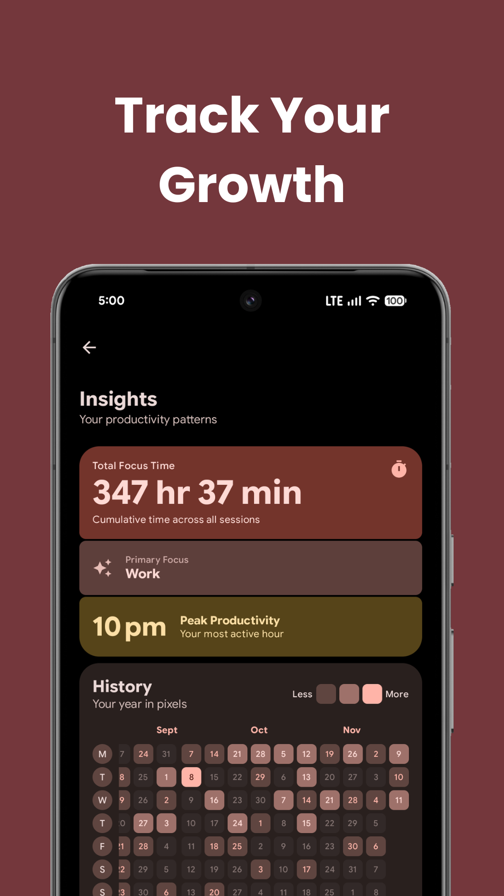
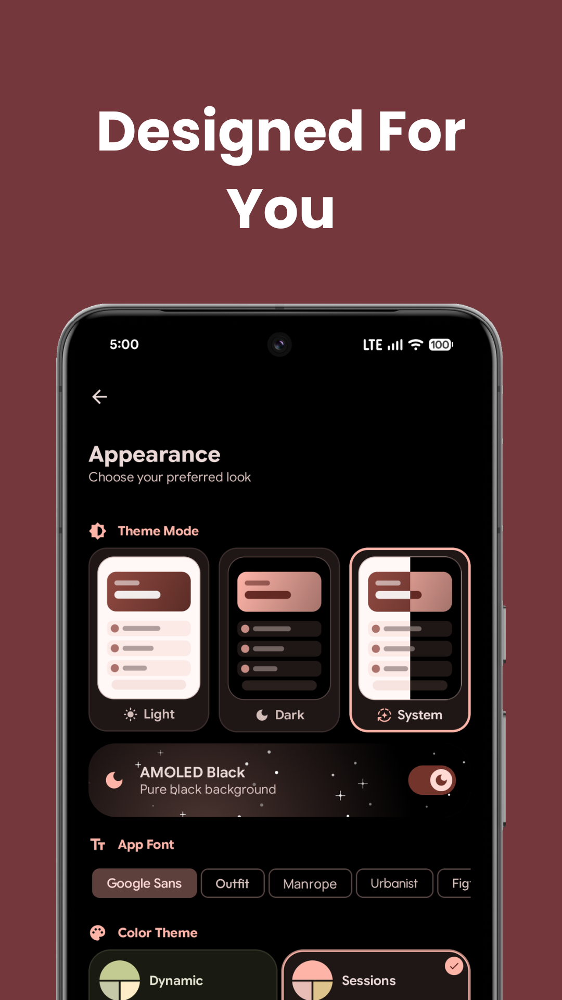
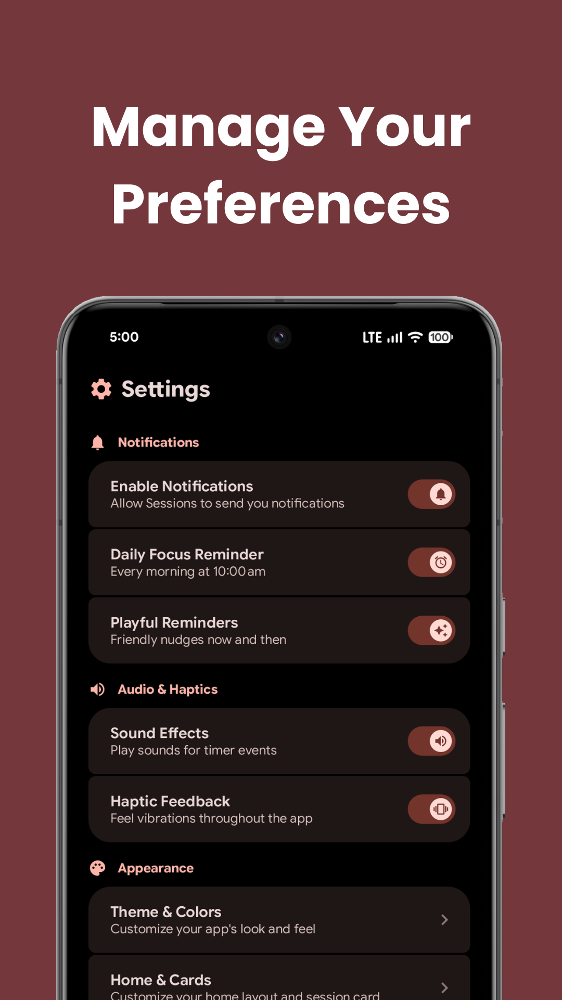
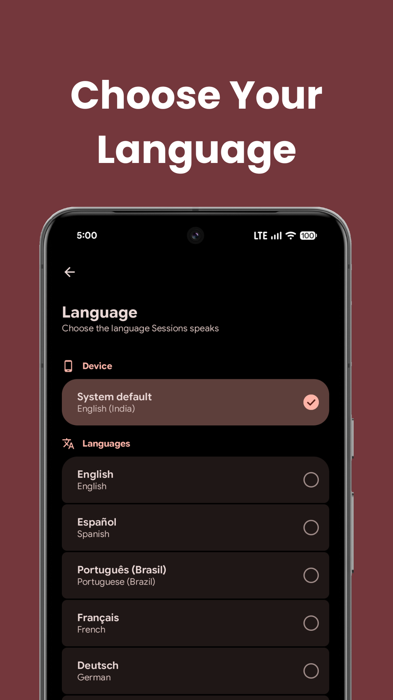
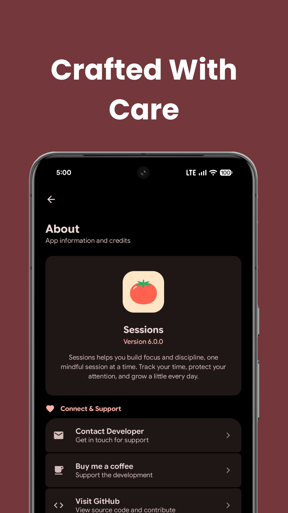
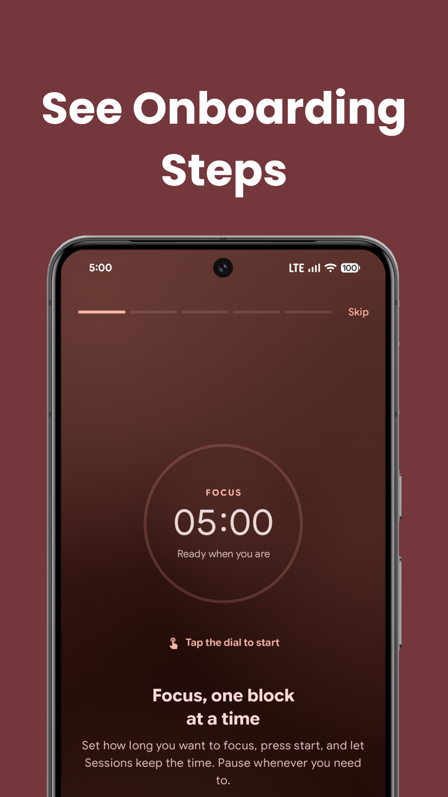
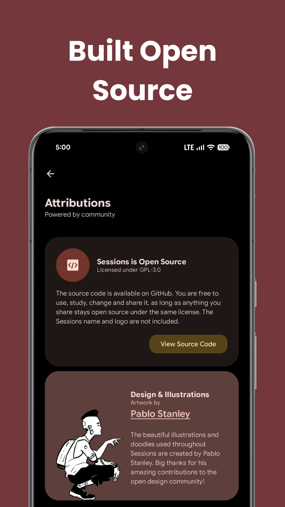

<div align="center">


<br/>

<table border="0" width="100%">
    <tr>
        <td width="30%" align="center" valign="middle">
            
        </td>
        <td width="70%" valign="middle">
            <h1>Sessions</h1>
            <h3>Your Personal Focus Companion</h3>
            <p><i>Precision-engineered productivity application designed to help you master your time and maintain flow state.</i></p>
        </td>
    </tr>
</table>

<p align="center">
  <a href="https://play.google.com/store/apps/details?id=com.yugentech.sessions"></a>
  <a href="https://github.com/MohammadAliUstad/Sessions/releases"></a>
</p>

<p align="center">
  <b>2,500+ Downloads</b> &nbsp;·&nbsp; <b>⭐ 4.9 Rating</b> &nbsp;·&nbsp; <b>60+ Reviews</b> on Google Play
</p>

<br/>

[Report Bug](https://github.com/MohammadAliUstad/Sessions/issues) · [Request Feature](https://github.com/MohammadAliUstad/Sessions/issues) · [Download Latest Release](https://github.com/MohammadAliUstad/Sessions/releases)

</div>

---

## Overview

Sessions transforms the concept of a simple timer into a comprehensive focus tool. Whether you're studying, coding, or writing, the application ensures your environment is optimized for concentration. It features a robust background service and intelligent reminder system that ensures your progress is tracked and your habits are maintained, even when life gets busy.

Sign in to keep your history backed up and synced across devices, or tap **Guest** to start focusing right away, with no account and everything kept on your phone.

---

## ✨ Key Features

### Focus Timer
- **Customisable Cycles:** Set your focus length, short break length and how many sets you're aiming for.
- **Flexible Long Breaks:** Choose the long break's length and how often it comes (every set, every 2 sets, and so on up to your target), or turn long breaks off.
- **Session Goal:** A progress card tracks your sets, shows how many are left and when your long break is due, and lets you skip ahead. Reach your goal and you get a small celebration.
- **Name Your Session:** Give each session a task, like *Coding* or *Reading*, so your history and insights show where your time went. You can rename it mid-session.
- **Templates:** Save a timer setup as a template and switch to it in one tap.
- **End Time at a Glance:** The timer shows the clock time your session will finish.
- **Keep Screen On:** Optionally stops the screen sleeping while a session runs.

### Sound & Feel
- **Background Ambience:** 6 sounds to focus to: Rain, Brown Noise, Fireplace, Library, Riverside and Forest.
- **Adaptive Volume:** Background sound gets quieter during breaks and comes back up when focus starts.
- **Sound Effects & Haptics:** Start, stop and goal sounds plus vibration, so you know what happened without looking. Each can be turned off.

### Reminders
- **Daily Focus Reminder:** One reminder a day at the time you pick.
- **Playful Reminders:** Friendly nudges when you've been away for a few days, never more than one a day and never on a day you've already focused. They have their own quiet notification channel, separate from the daily reminder.

### Notifications & Reliability
- **Live Notification:** A persistent notification on the lock screen and status bar shows your progress at a glance.
- **Quick Actions:** Pause, resume, skip or finish a session straight from the notification.
- **Background Stability:** Built to survive aggressive battery optimisation, so your timer doesn't stop unexpectedly.

### Insights & History
- **Insights:** Total focus time, your primary focus, your most productive hour, your consistency streak, your weekly rhythm and how your time splits between tasks.
- **Year in Pixels:** A heatmap of every day you've focused.
- **Streaks:** Your profile shows how many days in a row you've focused.
- **Session History:** Browse your sessions grouped by day, week or month. Delete them one at a time, a whole period at once, or all of them.

### Make It Yours
- **3 Home Layouts:** *Classic*, the original layout. *Refined*, which is calmer with the ring up front. *Studio*, with a dial and a floating dock. Refined and Studio can add a colour gradient at the top of the screen.
- **Session Card Styles:** Filled, Outlined or Glass, with an optional animated background: Desert crossing, Lo-fi rain, Candle & embers, Aurora or Mesh gradient.
- **8 Colour Themes:** Dynamic (Material You), Sessions, Twilight, Grove, Sakura, Lagoon, Harvest and Alpine, each in Light, Dark or System mode.
- **AMOLED Black:** Pure black backgrounds for OLED screens.
- **6 Fonts:** Google Sans, Outfit, Manrope, Urbanist, Figtree and Garamond.
- **Profile:** Pick one of the illustrated avatars, drawn by Pablo Stanley, and set your display name.
- **10 Languages:** English, Spanish, Portuguese (Brazil), French, German, Hindi, Arabic, Japanese, Korean and Simplified Chinese. Follow your phone's language or choose one in the app.

### Accounts & Your Data
- **Sign In or Go Guest:** Sign in with email or Google to back up and sync your sessions, templates and profile across devices, or continue as a guest with no account.
- **Private Guest Mode:** A guest's data never leaves the phone. No account is created, nothing is sent to the cloud, and it works offline from the first launch.
- **Backup Files:** Guests can export their sessions, templates and profile to a single file and import it later. Signed in? Import a guest backup from Settings and it syncs to your account. Imports merge, so nothing is ever doubled up.

### And More
- **Guided Onboarding:** A short tour on first launch that you can replay from Settings.
- **What's New:** See what changed in each update.
- **Support the Developer:** Leave an optional tip from the About screen.

---

## 📱 Screenshots

<div align="center">

<table width="100%">
  <tr>
    <td align="center" width="25%">
      
      <br/><sub><b>Timer</b></sub>
    </td>
    <td align="center" width="25%">
      
      <br/><sub><b>Dashboard</b></sub>
    </td>
    <td align="center" width="25%">
      
      <br/><sub><b>Insights</b></sub>
    </td>
    <td align="center" width="25%">
      
      <br/><sub><b>Home Layouts</b></sub>
    </td>
  </tr>
  <tr>
    <td align="center" width="25%">
      
      <br/><sub><b>Appearance</b></sub>
    </td>
    <td align="center" width="25%">
      
      <br/><sub><b>Settings</b></sub>
    </td>
    <td align="center" width="25%">
      
      <br/><sub><b>Language</b></sub>
    </td>
    <td align="center" width="25%">
      
      <br/><sub><b>About</b></sub>
    </td>
  </tr>
  <tr>
    <td align="center" width="25%">
      
      <br/><sub><b>Onboarding</b></sub>
    </td>
    <td align="center" width="25%">
      
      <br/><sub><b>Sign Up</b></sub>
    </td>
    <td align="center" width="25%">
      
      <br/><sub><b>Sign In</b></sub>
    </td>
    <td align="center" width="25%">
      
      <br/><sub><b>Attributions</b></sub>
    </td>
  </tr>
</table>

</div>

---

## Technical Architecture

Sessions is built using modern Android development standards, ensuring a codebase that is scalable, testable, and maintainable.

```text
Language:             Kotlin
UI Framework:         Jetpack Compose (Material 3)
Architecture:         MVVM + Clean Architecture
Dependency Injection: Koin
Local Database:       Room
Preferences:          DataStore
Backend Services:     Firebase (Auth, Firestore, Analytics, Crashlytics)
Concurrency:          Kotlin Coroutines & Flow
Background Tasks:     WorkManager
Animations:           Lottie
In-App Purchases:     Google Play Billing
Min / Target SDK:     26 (Android 8.0) / 37
```

### Tech Stack

* **Kotlin** - Modern, concise, and safe programming language.
* **Jetpack Compose** - Declarative UI toolkit for building native Android interfaces.
* **Material 3** - Latest Material Design system for beautiful, accessible UIs.
* **MVVM Architecture** - Separation of concerns for maintainable code.
* **Room Database** - Robust local data persistence.
* **DataStore** - Settings and preferences, stored on the device.
* **WorkManager** - Reliable background task scheduling for smart reminders.
* **Firebase** - Authentication and cloud sync for signed-in users, plus usage analytics and crash reporting. Guest mode runs entirely on the device.
* **Coroutines & Flow** - Asynchronous programming made simple.
* **Lottie** - Animated icons throughout the app.
* **Google Play Billing** - Optional tips to support development.

---

## Setup & Installation

### Prerequisites

* Android Studio (latest version recommended)
* JDK 11 or higher
* Android SDK API 26+

### Steps

1. **Clone the Repository**
```bash
git clone https://github.com/MohammadAliUstad/Sessions.git
cd Sessions
```

2. **Firebase Configuration**
* Create a project in the [Firebase Console](https://console.firebase.google.com/)
* Download the `google-services.json` file
* Place the file in the `app/` directory of the project
* In **Authentication**, enable the **Email/Password** and **Google** sign-in providers (guest mode needs no provider)
* Create a **Cloud Firestore** database. Each user's data is stored under `users/{uid}`, and the repo's [`firestore.rules`](firestore.rules) lets each signed-in user reach only their own data. Deploy them with the [Firebase CLI](https://firebase.google.com/docs/cli): `firebase deploy --only firestore:rules --project <your-project-id>`

3. **Build & Run**
* Open the project in Android Studio
* Sync Gradle files
* Select your target device/emulator
* Click Run ▶️

---

## 🤝 Contributing

Contributions are what make the open source community such an amazing place to learn, inspire, and create. Any contributions you make are **greatly appreciated**.

1. Fork the Project
2. Create your Feature Branch (`git checkout -b feature/AmazingFeature`)
3. Commit your Changes (`git commit -m 'Add some AmazingFeature'`)
4. Push to the Branch (`git push origin feature/AmazingFeature`)
5. Open a Pull Request

---

## 📄 License

Sessions is free and open source software, licensed under the **GNU General Public License v3.0 or later** (`GPL-3.0-or-later`). See [`LICENSE`](LICENSE) for the full text and [`NOTICE.md`](NOTICE.md) for the copyright notice and additional terms.

In short, you may use, study, modify and share the code. If you distribute a modified version, you must release its full source code under the same license and keep the copyright notices.

- **Google libraries:** an additional permission allows the app to be built with Firebase, Google Play services and the Google Play Billing Library.
- **Earlier releases:** versions published before this change were released under the Apache License 2.0 and remain available under those terms.

### Name and branding

The license covers the code, not the brand. The **Sessions** name, the **Yugen Tech** name, the logo, the app icon and the artwork in `graphics/`, `badges/` and `screenshots/` are **not** licensed under the GPL and remain all rights reserved.

If you publish a fork, give it a different name, icon and application ID, and don't present it as an official Sessions release. You're welcome to describe it as "based on Sessions" and link back here. See [`NOTICE.md`](NOTICE.md) for details.

### Contributing and licensing

By submitting a pull request, you agree that your contribution is licensed under GPL-3.0-or-later.

---

## Contact & Support

If you encounter any issues or have suggestions for future updates, please open an issue on GitHub or contact the developer directly.

**Developer:** Mohammad Ali Ustad

**Email:** Mohammadaliustad@gmail.com

**Company:** Yugen Tech

<div align="center">

### Show Your Support

If you find this project helpful, please consider giving it a ⭐!

</div>

---

<div align="center">
<sub>Built with ❤️ by Yugen Tech</sub>
</div>
